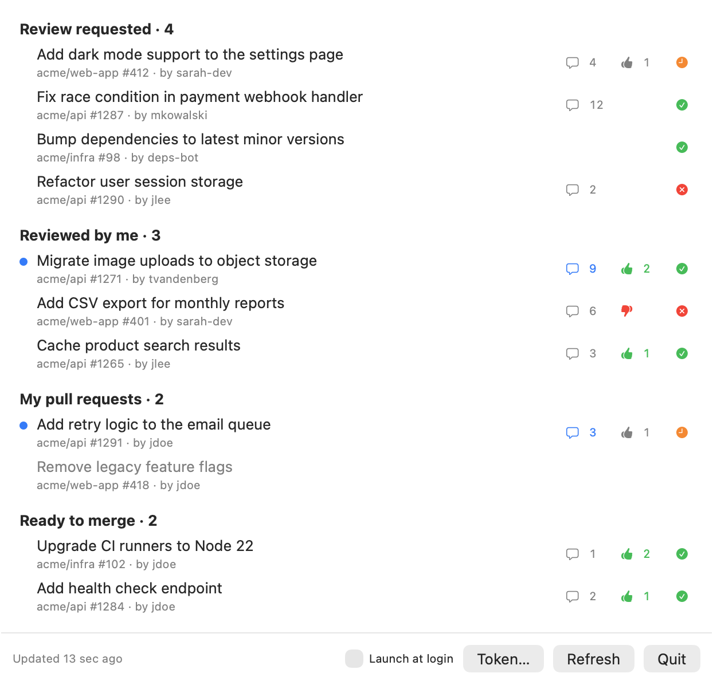

# PRadar

A native macOS menu bar app that keeps track of your GitHub pull requests — without the stale state of GitHub's own inbox.

<picture>
  <source media="(prefers-color-scheme: dark)" srcset="docs/screenshot-dark.png">
  
</picture>

- **Review requested** — pull requests waiting for your review.
- **Reviewed by me** — pull requests you already reviewed stay visible, so follow-up comments don't get lost.
- **My pull requests** — with review and check status.
- **Ready to merge** — your approved, conflict-free pull requests with passing checks.

A blue dot marks a pull request with activity from someone else (comments, reviews, commits) since you last interacted with it: your last submitted review, your last comment, or the last time you opened it from PRadar. The menu bar counter shows review requests plus every pull request with unseen activity.

## Requirements

- macOS 14 (Sonoma) or later
- A GitHub token: either the [GitHub CLI](https://cli.github.com) installed via Homebrew and logged in (`gh auth login`), or a [token pasted into PRadar](#token-and-permissions)

## Install from source

Requires Xcode or the Xcode Command Line Tools (Swift 6).

```bash
git clone https://github.com/lucastenboom/PRadar.git
cd PRadar
make install
```

This builds a release version, installs it to `~/Applications/PRadar.app` and starts it. Enable **Launch at login** in the footer of the popover to start PRadar automatically. Run `make install` again to update, `make uninstall` to remove it.

## Token and permissions

PRadar only reads data. By default it uses the token of the GitHub CLI, which usually has broad write scopes such as `repo` and `workflow`. To limit what the token can do, create a [fine-grained personal access token](https://github.com/settings/personal-access-tokens/new) with read-only access instead:

- **Pull requests:** Read-only
- **Contents:** Read-only
- **Commit statuses:** Read-only

A fine-grained token belongs to one resource owner: pick the organization (or your own account) that owns the repositories you want to track. Some organizations require an admin to approve fine-grained tokens.

Click **Token…** in the footer of the popover and paste the token. It is stored in your Keychain and takes precedence over the GitHub CLI. Because locally built apps are only ad-hoc signed, macOS asks for Keychain access again after every `make install`; choose **Always Allow**.

## Privacy

PRadar talks to `api.github.com` only. A pasted token is stored in your Keychain; a GitHub CLI token is only kept in memory. Neither is written anywhere else. To remember which pull requests you have seen, PRadar stores their URLs (including names of private repositories) with a timestamp in `~/Library/Preferences/io.github.lucastenboom.PRadar.plist`. Entries are removed once a pull request is closed or merged.

## Development

```bash
swift run      # run without installing
make test      # run the tests
make lint      # check formatting with swift-format
make format    # fix formatting
```

## License

[MIT](LICENSE)
